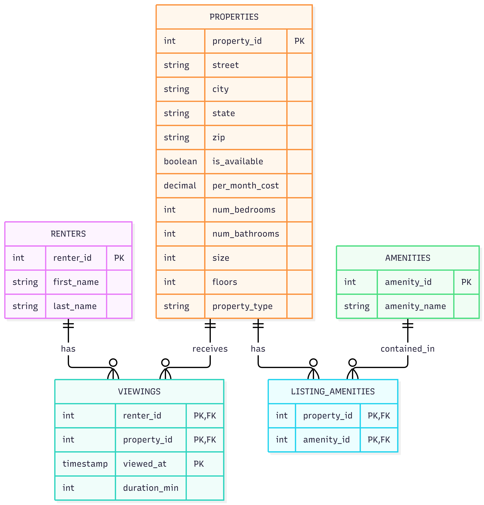

# ex603-rentalmarketplace-database

**Rental Marketplace Analytics Database (BU EX603).** A PostgreSQL database and SQL analysis of a residential rental marketplace, covering how renters view properties, where viewings fail, and whether the platform is getting better or worse over time.

## The domain

My name is Intisar Ratul, and the theme I chose for this project is a Rental Marketplace.


This project models a residential rental marketplace. **Renters** browse **properties** listed by landlords and book **viewings** to see them in person. Each property has **amenities** (such as parking or laundry) linked through a junction table. The central event is the viewing: who viewed which property, when, its status (attended, cancelled, or disputed), how long it lasted (`duration_min`), and, for cancellations, why it failed.

The platform has to answer questions such as: Which properties attract the most interest? How often do viewings fail, and whose fault is it? Is a property's viewing activity rising or falling? Is the platform as a whole improving month over month?

The project grew across six units: modelling the schema (Unit 1), implementing it in DDL (Unit 2), auditing a misleading failure-rate dashboard (Unit 3), aggregating results by property and region (Unit 4), joining tables to attribute results to producers (Unit 5), and analysing trends with window functions (Unit 6).

## Database overview



### My schema design (Units 1–2)

My own design ([`schema/schema.sql`](schema/schema.sql)) has five tables, created in this order:

- **renters** (actor): people who view properties. Key: `renter_id`.
- **properties** (producer): rental listings with address parts, cost, bedrooms, bathrooms, size, floors, type, and an availability flag. Key: `property_id`.
- **amenities** (catalog): named features such as Pool or Gym. Key: `amenity_id`.
- **viewings** (event): one row per renter viewing a property, with `viewed_at` and `duration_min`. Composite key: (`renter_id`, `property_id`, `viewed_at`).
- **listing_amenities** (junction): links properties to amenities (many-to-many). Composite key: (`property_id`, `amenity_id`).

Design decisions:
- Deleting a renter is blocked while they have viewings (RESTRICT), so the duration data behind aggregate statistics is never lost. All other foreign keys use CASCADE.
- Seven CHECK constraints keep invalid values out: no negative counts or prices, a fixed set of property types, and durations above zero.
- Money is `NUMERIC(10,2)`, never floating point.
- Names and addresses are split into parts so they can be filtered and sorted; the full name is computed at query time.
- `schema.sql` can be re-run at any time because it drops the tables first, in reverse creation order.

### Dataset used for the analysis (Units 3–6)

From Unit 3 on, all queries run against the course-provided dataset (`rental.sql`, provided DDL and data) loaded into a database named `ex603_data`. The tables relevant to the analysis:

| Table | Role | Key columns used |
|---|---|---|
| `viewings` | Event (one row per viewing, 200 rows) | `viewing_id`, `renter_id`, `property_id`, `scheduled_at`, `viewing_status`, `duration_min`, `no_show_reason` |
| `properties` | Producer (15 listings; 13 have viewings) | `property_id`, `property_label`, `city`, `monthly_rent`, `is_available` |
| `renters` | Actor | `renter_id`, `renter_name` |
| `amenities`, `listing_amenities` | Catalog (5 amenities) and junction | `amenity_id`, `amenity_name` |

`viewing_status` is attended, cancelled, or disputed. Cancelled viewings record `duration_min = 0`, which matters for every average and trend in this project.

## Query catalogue

### Unit 3: Retrieval, filtering, and the dashboard audit
| File | Business question |
|---|---|
| [q3_1.sql](queries/unit3/q3_1.sql) | Which viewings match given filters (status, dates, cities, missing values)? |
| [q3_2.sql](queries/unit3/q3_2.sql) | Why did the dashboard report ~50% no-shows, and what is the true rate? |
| [q3_3.sql](queries/unit3/q3_3.sql) | The same question answered three ways (IN, CTE, EXISTS) |

### Unit 4: From rows to insight
| Query | File | Business question |
|---|---|---|
| 4.1a | [q4_1.sql](queries/unit4/q4_1.sql) | What does the platform look like overall: how many viewings, their total, average, shortest and longest duration, and how many distinct renters? |
| 4.1b | [q4_1.sql](queries/unit4/q4_1.sql) | How many viewings does each property get, and how long do renters stay on average? |
| 4.1c | [q4_1.sql](queries/unit4/q4_1.sql) | Which properties have enough viewings (more than 15) for their numbers to be meaningful? |
| 4.1d | [q4_1.sql](queries/unit4/q4_1.sql) | How do viewing count and average duration vary by city and viewing status? |
| 4.2A | [q4_2.sql](queries/unit4/q4_2.sql) | For each property, how many viewings did it have and how many were renter no-shows? |
| 4.2B | [q4_2.sql](queries/unit4/q4_2.sql) | What is each city's viewing and no-show subtotal, and what is the platform-wide grand total? |
| 4.2C | [q4_2.sql](queries/unit4/q4_2.sql) | What is the baseline no-show rate for high-volume properties? |

Write-ups: [analysis/unit4.md](analysis/unit4.md), [analysis/unit4-finding.md](analysis/unit4-finding.md)

### Unit 5: Joins and execution plans
| Query | File | Business question |
|---|---|---|
| 5.1 Q1 | [q5.1.sql](queries/unit5/q5.1.sql) | Who are the people behind the events: which renter viewed which property, and when? |
| 5.1 Q2 | [q5.1.sql](queries/unit5/q5.1.sql) | Which properties share the Pool amenity (producer → junction → catalog)? |
| 5.1 Q3 | [q5.1.sql](queries/unit5/q5.1.sql) | Which properties are in the same city as each other (self join)? |
| 5.2A | [q5.2.sql](queries/unit5/q5.2.sql) | Which properties does an INNER JOIN silently drop compared with a LEFT JOIN? |
| 5.2B | [q5.2.sql](queries/unit5/q5.2.sql) | Do RIGHT JOIN and FULL OUTER JOIN return the same properties, and is anything unmatched on either side? |
| 5.2C | [q5.2.sql](queries/unit5/q5.2.sql) | Which properties have never had a viewing (NOT EXISTS vs EXCEPT)? |
| 5.3A | [q5.3.sql](queries/unit5/q5.3.sql) | How many rows does a CROSS JOIN of amenities and properties produce, and when is that a mistake? |
| 5.3B | [q5.3.sql](queries/unit5/q5.3.sql) | How does PostgreSQL execute the three-table join, and what would slow down as data grows? |

### Unit 6: Window functions
| Query | File | Business question |
|---|---|---|
| 6.1a | [q6_1.sql](queries/unit6/q6_1.sql) | How does each viewing's duration compare with its property's average? |
| 6.1b | [q6_1.sql](queries/unit6/q6_1.sql) | What is each property's average duration (GROUP BY comparison)? |
| 6.1c | [q6_1.sql](queries/unit6/q6_1.sql) | How do properties rank by number of viewings, and how is each tie treated? |
| 6.1d | [q6_1.sql](queries/unit6/q6_1.sql) | Which of four bands does each property fall into by viewings? |
| 6.2A | [q6_2.sql](queries/unit6/q6_2.sql) | For property 4, is each viewing longer or shorter than the one before? |
| 6.2B | [q6_2.sql](queries/unit6/q6_2.sql) | How many viewing minutes has the platform accumulated, and what is the recent trend? |
| 6.2C | [q6_2.sql](queries/unit6/q6_2.sql) | Which properties went more than 60 days without a viewing? |
| 6.3A | [q6_3.sql](queries/unit6/q6_3.sql) | What are the three longest viewings for each property? |
| 6.3B | [q6_3.sql](queries/unit6/q6_3.sql) | Is the platform getting better or worse each month? |

Write-ups: [analysis/unit6.md](analysis/unit6.md), closing memo [analysis/unit6-finding.md](analysis/unit6-finding.md)

## Technical highlights

1. **NULL-safe filtering (Unit 3).** The dashboard used `WHERE no_show_reason != 'Renter cancelled'`, which silently dropped all 166 rows where the reason was NULL, inflating the no-show rate from about 6% to about 50%. Adding `OR no_show_reason IS NULL` fixed it.
2. **Conditional aggregation and ROLLUP (Unit 4).** `COUNT(CASE WHEN ...)` counted no-shows per property in one pass, and `GROUP BY ROLLUP` added regional and platform totals without separate queries.
3. **Window functions that keep rows (Unit 6).** `AVG(...) OVER (PARTITION BY property_id)` put each viewing next to its property's average, returning 200 rows instead of the 13 from `GROUP BY`, which made unusual viewings (70.86 minutes vs a 19.49 average) visible. `ROW_NUMBER`, `RANK`, and `DENSE_RANK` side by side showed how ties are treated; `DENSE_RANK` was chosen for a renter-facing leaderboard.
4. **LEFT JOIN vs INNER JOIN, and EXPLAIN ANALYZE (Unit 5).** An INNER JOIN of properties to viewings returned 13 properties; a LEFT JOIN returned 15, exposing properties 14 and 15, which have never had a viewing (confirmed with both NOT EXISTS and EXCEPT). EXPLAIN ANALYZE showed PostgreSQL using a Hash Join and a Memoized Nested Loop on the primary-key index (187 cache hits, 13 misses, 0.268 ms).
5. **CTEs to filter window results (Unit 6).** Window results can't be filtered in the same query's `WHERE`, so a CTE computed the gap between viewings with `LAG(scheduled_at)` and the outer query kept only gaps over 60 days.

## Findings and recommendations

1. **The failure rate was overstated.** The true no-show rate is about 6%, not 50%; the dashboard bug came from NULL handling. Recommendation: replace the dashboard query and report disputed viewings separately.
2. **Activity is volatile, and failures come in bursts.** Viewing minutes fell 70% from February to March 2023 (viewings dropped from 21 to 11, with a 27% cancellation rate), then recovered to a September peak. The cancellation rate improved from 18.8% in January–June to 15.2% in July–December. Recommendation: track cancellations by reason, and alert when the 8-day moving average drops below about 15 minutes.
3. **The platform missed its activity target every quarter.** Against 80 minutes per week, it reached 87.2% for the year (best quarter: Q3 at 96.5%). Nine of the 13 viewed properties went more than 60 days without a viewing, and two properties (14 and 15) have never been viewed at all. Recommendation: investigate long gaps and record listing-availability history.

Full memo: [analysis/unit6-finding.md](analysis/unit6-finding.md)

## Limitations and future improvements

The dataset covers a single year (2023) and does not record when a property's availability changed. That means a long gap in viewings can't be definitively classified as a property being off the market versus simply not being shown, and the March drop can't yet be called seasonal. Adding listing-availability history and at least a second year of data would allow both questions to be answered, and would support a year-over-year comparison.

## Video presentation

[Watch the video walkthrough on YouTube](https://youtu.be/ardE6zC2QEk)

## How to run it

Requires PostgreSQL 14+ and the `psql` command-line client.

```bash
# 1. Create the database
createdb ex603_data

# 2. Load the course dataset (schema + data)
psql -d ex603_data -f rental.sql

# 3. Run any query file
psql -d ex603_data -f queries/unit6/q6_1.sql
```

In DataGrip, right-click the database → **SQL Scripts → Run SQL Script…** and select `rental.sql` (not Import Data, which misreads the script). Then open any `.sql` file in `/queries` and run it.
